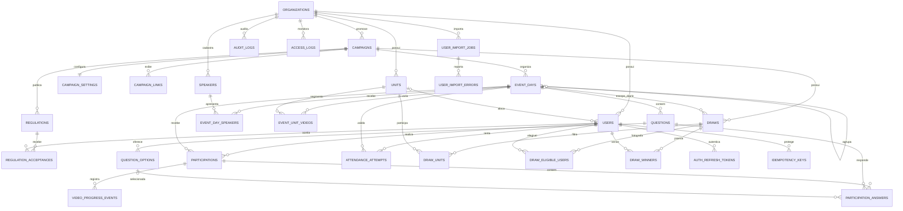

# Modelo Relacional MySQL/MariaDB

O DDL executavel esta em `database/schema.sql`. Este documento explica os limites de dominio, os relacionamentos e as transacoes preservadas pela API Node.js em `backend/`.

## 1. Diagrama entidade-relacionamento



## 2. Catalogo de tabelas

Todos os IDs abaixo sao `CHAR(36)` UUID. Tabelas mutaveis usam `created_at`, `updated_at` e `deleted_at`; logs append-only usam data de ocorrencia e criacao.

| Tabela | Colunas de negocio principais | Restricoes/indices | Relacionamentos |
|---|---|---|---|
| `organizations` | `name VARCHAR(180)`, `slug VARCHAR(120)`, `active BOOL` | slug unico | raiz de unidades, usuarios e campanhas |
| `units` | `organization_id`, `name`, `slug`, `active`, `sort_order` | `(organization_id, slug)` unico | N:1 organizacao; 1:N usuarios |
| `users` | organizacao/unidade, matricula, e-mail, hash de senha, nomes, papel, flags | matricula e e-mail unicos por organizacao; papel validado por CHECK | N:1 organizacao/unidade |
| `campaigns` | organizacao, nome, slug, ano, timezone, janela, status | slug unico por organizacao; ano/janela validados | N:1 organizacao |
| `campaign_settings` | logos, banners, limiar de video, mascara, cores e textos | PK/FK `campaign_id`; limiar 0..100 | 1:1 campanha |
| `campaign_links` | label, URL, nova aba, ordem | indice campanha/ordem | N:1 campanha |
| `regulations` | campanha, versao, titulo, HTML, PDF, vigencia, publicacao | versao unica por campanha | N:1 campanha; 1:N aceites |
| `regulation_acceptances` | regulamento, usuario, data, hashes de IP/UA | um aceite por usuario/versao | N:1 usuario e regulamento |
| `event_days` | campanha/pai, slug, janela, videos, hash de presenca, flags | slug unico por campanha; fechamento > abertura | N:1 campanha; auto-relacao pai/filho |
| `speakers` | organizacao, nome, cargo, imagem | indice organizacao/nome | N:N dias via associacao |
| `event_day_speakers` | dia, palestrante, ordem | PK composta | N:N |
| `event_unit_videos` | dia, unidade, URL | PK composta | N:N especializado |
| `questions` | dia, titulo, tipo, obrigatoria, pontuada, prompt, ordem | tipo e flags por CHECK; pontuada somente escolha unica | N:1 dia |
| `question_options` | pergunta, texto, correta, nota, ordem | indices por pergunta/correta; rating 1..10 | N:1 pergunta |
| `participations` | usuario/dia, modalidade, presenca, progresso, status e nota | uma por usuario/dia; percentuais 0..100 | N:1 usuario e dia |
| `participation_answers` | participacao, pergunta, opcao/texto/rating/sugestao, correcao | uma resposta por pergunta/participacao; FK composta garante opcao da pergunta | N:1 participacao/pergunta/opcao |
| `video_progress_events` | participacao, evento cliente, segundos e data | idempotencia por evento cliente; segundos consistentes | N:1 participacao |
| `attendance_attempts` | usuario, dia, resultado, hash IP e data | indice usuario/dia/data para rate limit | N:1 usuario/dia |
| `draws` | campanha, escopo, premio, contagens, status, autores/anulacao | escopo e contagens por CHECK | N:1 campanha/dia/usuarios autores |
| `draw_units` | sorteio, unidade | PK composta | N:N sorteio/unidade |
| `draw_eligible_users` | sorteio, usuario | PK composta | snapshot N:N imutavel |
| `draw_winners` | sorteio, usuario, posicao e campos snapshot | posicao e usuario unicos por sorteio | N:1 sorteio/usuario |
| `audit_logs` | organizacao/campanha/ator, acao, entidade, before/after JSON | indices por data, ator e entidade | append-only |
| `access_logs` | organizacao/usuario, matricula tentada, resultado, hashes | indices para seguranca e rate limit | append-only |
| `auth_refresh_tokens` | usuario, hash do token, validade/revogacao | hash unico; nunca salvar token puro | N:1 usuario |
| `idempotency_keys` | usuario, operacao, chave, request hash e resposta | chave unica por usuario/operacao | N:1 usuario |
| `user_import_jobs` | organizacao/autor, status, arquivo e contagens | indices por organizacao/status | N:1 organizacao/autor |
| `user_import_errors` | job, linha, identificadores e erro | indice job/linha | N:1 job |

## 3. Normalizacao e excecoes intencionais

O modelo segue 3FN: listas e objetos que estavam embutidos no TypeScript viraram tabelas (`speakers`, links, opcoes, respostas, unidades de sorteio e snapshots elegiveis). O aceite do regulamento deixou de ser duas colunas em `users`, permitindo varias versoes e prova historica.

Excecoes intencionais:

- `draw_winners` guarda nome, matricula, e-mail, unidade e empresa como snapshot. Isso preserva o resultado oficial mesmo se o cadastro mudar.
- `audit_logs.before_data/after_data` sao JSON porque o conjunto de campos varia por entidade e nao participa das regras transacionais.
- `company_name` fica em usuario enquanto nao existir evidencia de um cadastro corporativo administravel. Criar uma tabela `companies` quando empresas precisarem de identidade propria.

## 4. Invariantes que exigem transacao na API

### Submissao de questionario

1. Iniciar transacao e bloquear a participacao por `(user_id, event_day_id)`.
2. Confirmar usuario ativo, janela aberta e liberacao por presenca/video.
3. Rejeitar se o status ja for `submitted`.
4. Ler perguntas/opcoes ativas do banco; nunca aceitar gabarito do cliente.
5. Validar obrigatorias, calcular nota e inserir respostas.
6. Atualizar participacao para `submitted` e gravar auditoria.
7. Confirmar tudo ou desfazer tudo.

O indice unico usuario/dia e uma chave de idempotencia impedem submissao duplicada por concorrencia.

### Execucao de sorteio

1. Iniciar transacao com nivel de isolamento apropriado.
2. Recalcular elegiveis no momento da execucao.
3. Para semana completa, exigir nota perfeita em todo dia ativo `counts_for_full_week=1`.
4. Excluir vencedores anteriores se configurado.
5. Gerar selecao com `crypto.randomInt()` no Node.js, evitando vies de modulo.
6. Inserir sorteio, unidades, snapshot elegivel e vencedores.
7. Gravar auditoria e confirmar.

Anulacao atualiza status e metadados; nunca apaga o sorteio.

### Desativacao de usuario

- Executar soft delete (`active=0`, `deleted_at` preenchido).
- Impedir desativacao da propria sessao e do ultimo admin ativo.
- Revogar refresh tokens na mesma transacao.
- Preservar participacoes, sorteios e logs.

## 5. Mapeamento para ORMs

- Prisma: `String @id @db.Char(36)` e `DateTime @db.DateTime(3)`; mapear nomes snake_case com `@map/@@map`.
- TypeORM: `@PrimaryColumn({ type: 'char', length: 36 })`; usar migrations, nao `synchronize: true` em producao.
- Drizzle: `char('id', { length: 36 }).primaryKey()` e transacoes do driver MySQL.
- `BIGINT` nao foi usado como ID. Caso o ORM transforme BIGINT em `bigint` JS, essa complexidade fica evitada.
- Gerar UUID na aplicacao antes do insert; nao depender de default especifico do MySQL.

## 6. Importacao

### Hostinger Web/Cloud

1. Criar o banco e usuario no hPanel.
2. Abrir o banco no phpMyAdmin.
3. Importar `database/schema.sql`.

Esse arquivo pressupoe que o banco correto ja esteja selecionado e nao usa comandos proibidos na importacao compartilhada (`CREATE/DROP DATABASE`, `DEFINER`, trigger ou procedure).

### Local/VPS

No cliente MySQL, a partir da pasta `database/`:

```bash
mysql -u root -p < create-database.sql
```

`create-database.sql` cria/seleciona `sipat_portal` e carrega `schema.sql` por `SOURCE`.

## 7. Retencao e LGPD

A organizacao deve aprovar prazos antes da API entrar em producao. Sugestao inicial, sujeita ao juridico:

- access logs e tentativas: 90 a 180 dias;
- progresso granular de video: agregar e remover apos fechamento/auditoria da campanha;
- participacoes e sorteios: prazo corporativo/legal definido;
- refresh tokens: excluir apos expiracao/revogacao e janela de seguranca;
- soft-deleted users: anonimizar PII quando a obrigacao de retencao terminar;
- backups: criptografados, com acesso minimo e teste periodico de restauracao.
